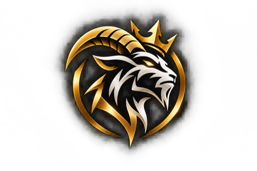

# GoatCash

<p align="center">
  
</p>

[Polska wersja: README.pl.md](README.pl.md)

An open crypto market intelligence platform: analytical agents, forecasts settled in a
Forecast Ledger, calibration and self-learning within hard limits, and, in later stages, a
trading bot with gradually increasing autonomy.

> **Status:** stages **E0–E2** are complete (gates G0–G2 passed: accounts and tools;
> repository, CI and secrets; detailed architecture, data model and contracts). Next: **E3**
> (base infrastructure). Features arrive according to the E0–E18 roadmap; every stage ends
> with a quality gate that is checked automatically. Current state: `docs/stan-pracy.md`.

## Layout

```
apps/web/              Next.js (frontend)
services/platform/     Python package `goatcash` (api, worker, ingest, scheduler)
services/executor/     trading bot executor (separate image, separate secrets)
packages/contracts/    OpenAPI, event JSON Schemas, Evidence contract, TS client
ml/                    training and notebooks (no data)
prompts/               versioned LLM prompts
infra/terraform/       Oracle, Cloudflare (from E3)
infra/ansible/         server configuration (from E3)
infra/compose/         Docker Compose for dev, staging, prod (from E3)
infra/secrets/         *.enc.yaml files encrypted with SOPS + age
docs/adr/              architecture decision records (ADR-0001…0006)
docs/architektura/     threat model (STRIDE) and C4 diagrams
docs/wymagania.yaml    functional and non-functional requirements
docs/gates/            quality gate reports
tests/e2e/             Playwright (from E12)
.github/workflows/     CI/CD
```

## Getting started (macOS)

`make doctor` checks the required tools (gate G0). Then:

```bash
make install     # uv sync + pnpm install + pre-commit hooks
make lint        # ruff + Biome
make typecheck   # pyright (strict) + tsc
make imports     # module boundaries (import-linter)
make test        # pytest with coverage + vitest
make gate G=1    # automated checks of a gate (G=1, G=2, ...), report in reports/gates/
```

Contracts and database (gate G2; migrations need Docker Desktop running):

```bash
make db-migration-test   # Alembic upgrade/downgrade on Postgres 17 + TimescaleDB
make event-schemas-test  # event JSON Schemas: valid examples pass, invalid are rejected
make evidence-test       # Evidence v1 contract
make openapi-lint        # OpenAPI matches the app, Spectral, TS client up to date
make openapi             # regenerate OpenAPI and the TS client after an API change
make requirements-check  # every requirement has an ID, stage, gate and measurable target
```

## Security

The repository only contains what could be printed on the front page of a newspaper.
Secrets are either encrypted with SOPS or kept outside the repo; `SECURITY.md` describes
the five layers of protection and how to report a vulnerability privately.

## License

[GNU AGPL-3.0](LICENSE): anyone who offers a modified version as a network service must
publish its source code.

Project documentation (roadmap, decisions, quality gates) is written in Polish.
