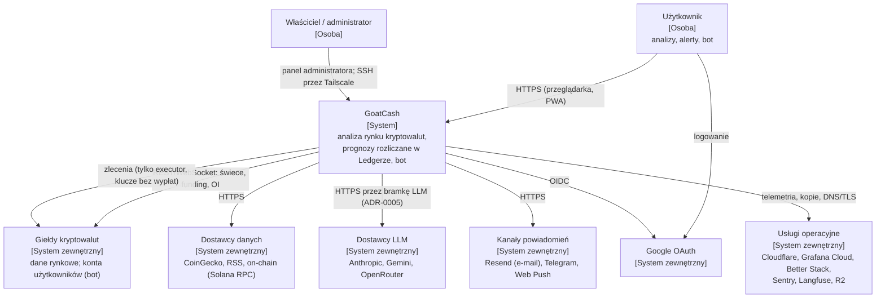
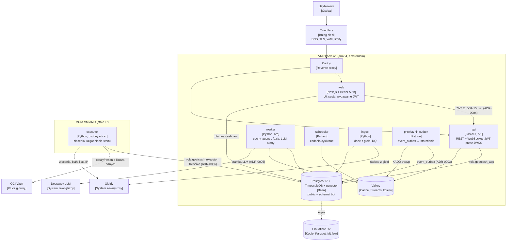

# Diagram C4: kontekst i kontenery

- **Etap:** E2 (roadmapa: „Pozostałe dokumenty etapu”, punkt 4). Data: 2026-11-23.
- **Format:** Mermaid (decyzja właściciela z 22.11.2026), renderowany przez GitHub. Diagramy
  w notacji C4 narysowane jako `flowchart`, bo ten typ Mermaid GitHub renderuje stabilnie.
- **Źródła:** Fundamenty sekcja 2 (procesy i przepływy), ADR-0001…0006, model zagrożeń
  [`stride.md`](stride.md). Zmiana procesu, magazynu albo integracji = aktualizacja tego pliku
  w tym samym PR.

## Poziom 1: kontekst systemu

## Poziom 2: kontenery

## Zasady widoczne na diagramach

- Executor nie ma połączeń z Valkey ani z `api`; jedyna droga do niego to tabela
  `bot.order_intents` w Postgresie (ADR-0006, STRIDE: executor).
- Każdy proces łączy się z bazą własną rolą z najmniejszymi uprawnieniami (ADR-0002; test
  `test_roles_have_least_privilege`).
- Zdarzenia powstają w transakcji z danymi (`event_outbox`), a strumienie tylko powiadamiają
  (ADR-0003).
- Z internetu dostępne są wyłącznie `web` i `api` przez Cloudflare i Caddy.
